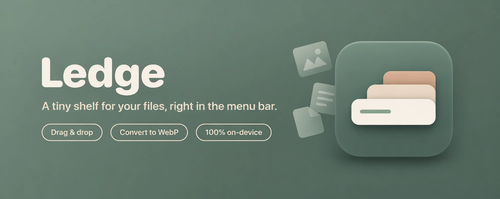

<p align="center">
  
</p>

<p align="center">
  <a href="https://www.producthunt.com/products/ledge-7?embed=true&amp;utm_source=badge-featured&amp;utm_medium=badge&amp;utm_campaign=badge-ledge-8" target="_blank" rel="noopener noreferrer"></a>
  <a href="https://ko-fi.com/Q5Q06K4FD"></a>
</p>

<p align="center">
  <a href="https://github.com/NeeL21YT/Ledge/releases"></a>
  <a href="https://github.com/NeeL21YT/Ledge/releases/latest"></a>
  <a href="LICENSE"></a>
  
</p>

# Ledge: free, open-source file shelf and image converter for macOS

**Ledge is a free, open-source macOS menu-bar app that holds files on a temporary shelf while you drag and drop between apps.** Shake a file while you drag it and a shelf appears under your pointer. Ledge also converts images between WebP, PNG, JPEG and GIF on your Mac (HEIC, JPG, PNG and more to WebP, and WebP back to PNG or JPEG), in unlimited batches, with no uploads.

| | |
|---|---|
| **What it is** | Menu-bar drag-and-drop file shelf plus a batch image converter |
| **Price** | Free, no ads, no account, no subscription |
| **License** | [Apache 2.0](LICENSE), open source |
| **Platform** | macOS 13 or later on Apple silicon (the download is arm64; Intel Macs can build from source), native Swift and AppKit |
| **Size** | About 3 MB on disk, about 20 MB of memory, 0% CPU when idle |
| **Privacy** | Everything runs on your Mac. The only network feature is the optional iCloud Drive link |
| **Converts** | Reads HEIC, JPG, PNG, GIF, TIFF, BMP, PSD, DNG, AVIF, SVG, PDF and WebP. Writes WebP, PNG, JPEG or GIF |
| **Author** | Nilutpal (NeeL), [GaLaXantic Studios](https://github.com/NeeL21YT/Ledge) |
| **Install** | DMG download, Homebrew (`brew install --cask NeeL21YT/ledge/ledge`) or build from source |
| **Latest version** | 1.5.0 (2026) |

---

## Contents

- [What is Ledge?](#what-is-ledge)
- [How do I convert images to WebP on a Mac?](#how-do-i-convert-images-to-webp-on-a-mac)
- [How does shake-to-open work?](#how-does-shake-to-open-work)
- [Features](#features)
- [Install and build](#install-and-build)
- [Using Ledge](#using-ledge)
- [Settings and storage](#settings-and-storage)
- [Frequently asked questions](#frequently-asked-questions)
- [Architecture](#architecture)
- [Project layout](#project-layout)
- [Design decisions](#design-decisions)
- [Known limitations](#known-limitations)
- [Origin and legal](#origin-and-legal)

---

## What is Ledge?

Ledge is a free, open-source temporary file shelf for macOS. It lives in the menu bar and solves a common problem: you are dragging a file, but the place you want to drop it is in another app, another Space or another folder that you cannot reach yet. Shake the file while you drag and Ledge opens a small shelf under your pointer. Drop the file on it, go where you need to, then drag it back out. A shelf can hold files, folders, images, web links and text, and it never moves or copies the originals. Ledge is a free alternative to shelf apps such as Dropover and Yoink. It is a native Swift app of about 3 MB, and it adds a built-in batch image converter, renaming, custom actions and iCloud Drive links.

## How do I convert images to WebP on a Mac?

Ledge converts any image to WebP in two ways, and it all happens on your Mac with no uploads. **Quick Convert** is one click: put images on a shelf, open the shelf menu and choose *Quick Convert to WebP*. The converted files replace the originals on the shelf, and the originals on disk stay untouched. **Convert Images…** opens a full window for batches of any size, including whole folders. It reads HEIC, JPG, PNG, GIF, TIFF, BMP, PSD, DNG, AVIF, SVG and the first page of a PDF. It lets you set quality, lossless mode, resizing, a before/after preview with file sizes, a watermark and file renaming. It can also turn WebP back into PNG, JPEG or an animated GIF. EXIF and GPS data are removed by default, which helps when you share photos online.

## How does shake-to-open work?

1. **Start dragging** a file (or text, an image, a link) in any app.
2. **Shake** the mouse left and right. A shelf opens under the pointer.
3. **Drop** onto the shelf. Release the drag anywhere else and an empty shelf closes by itself.
4. **Later**, drag the shelf's contents out into any app. The preview stack drags every file at once.

A shelf has two faces:

| Compact | Expanded |
|---|---|
| A small square showing a stacked preview of the files. ✕ closes, ⌄ opens the actions menu, and the pill at the bottom shows the file name (or "3 Images") and expands the shelf. | A grid or list of every file with its size and, for images, its pixel dimensions. A ‹ button collapses it again, and a trailing "Reveal in Finder" tile selects everything in Finder. |

## Features

**Getting files onto a shelf**

- Shake-to-open while dragging, with adjustable sensitivity. You can exclude specific apps or file types so the shelf stays out of the way.
- Drop anywhere on the shelf: files and folders, file promises from apps like Mail and Photos, raw images (saved as PNG), web links (saved as `.webloc`), and plain text (saved as `.txt`).
- Add from the clipboard (`⌃⌥V`, the menu bar, or the shelf menu) and add through a file picker.
- Files that Ledge creates are staged in `~/Library/Caches/Ledge` and cleaned up after 3 days. Files you drop onto a shelf are never copied or moved; they only change when you drag them back out.

**Getting files out**

- Drag any item, or the whole preview stack in compact mode, into any app. Dropping into a folder moves the file by default; turn on *Copy files instead of moving them when dragging out* in Settings to copy instead.
- Items are for dragging, not opening. There is no double-click to open.
- `⌘`/`Shift`-click multi-selects a few items before dragging them.

**Actions** (right-click an item, or use the ⌄ / sliders button)

- Open With, Show in Finder, Quick Look (also `Space`)
- Share through the system share services: AirDrop, Mail, Messages, Notes, and a More submenu
- Copy, Copy to…, Move to…, Compress into a zip
- **Rename…** renames the selected files on disk. One file gets a name field; several get a rule (prefix, suffix, find and replace, or numbering) with a live preview.
- **Copy iCloud Link** puts a public iCloud Drive link on the clipboard. Files already in iCloud Drive are published as they are; others are copied into `iCloud Drive/Ledge Shares` first, so the original never moves. It needs iCloud Drive turned on and may take a moment while the file uploads.
- **Actions** submenu with your own custom actions (see below).
- Add Files…, Add From Clipboard, Clear Shelf, Remove from Shelf
- Dock to Edge: the shelf tucks against the nearest screen edge and slides out when the pointer touches it
- Settings…

**Image converter** (right-click → Convert Images…, menu bar → Convert Images…, or `open ledge://convert`)

- Any image to WebP, and WebP to PNG, JPEG, or animated GIF. Reads HEIC, PNG/APNG, JPG, GIF, TIFF, BMP, PSD, DNG, JPEG 2000, PBM/PGM, SVG, AVIF, the first page of PDFs, and WebP. Animated GIF/APNG/WebP stay animated when going to WebP or GIF.
- Batches of any size, folders included (searched recursively). Files finish on a shelf, next to the originals, or in a folder you choose.
- Encoder settings: quality, lossless, preset, method, Sharp YUV, keep color profile.
- **Quick Convert** in the shelf menu: one click, no window, with its own options in Settings. Converted files replace their sources on the shelf.
- Resize to a max width/height with the aspect ratio kept (never enlarges).
- Before/after preview window with file sizes and the percentage saved.
- Presets, and renaming by prefix, suffix, find/replace, or numbering.
- EXIF/GPS data is removed by default; opt in to keep it, the original extension, and the original file dates.
- Watermark with a logo image or text: position, size, opacity.
- Everything runs on the Mac. No uploads, no account, no limits.

**Around the edges**

- A short **Welcome Guide** window on first launch, reopenable from the menu bar.
- Menu-bar item with **Recent Shelves** (the last 8 non-empty shelves) and a Launch at Login toggle.
- Global shortcuts: `⌃⌥Space` opens a new shelf and `⌃⌥V` opens one from the clipboard.
- URL scheme for scripts: `open ledge://new` and `open ledge://clipboard`.
- Always dark, translucent HUD look, with grid and list layouts.

## Install and build

### Download the app (easiest)

1. Download **Ledge-1.5.0.dmg** from the [latest release](https://github.com/NeeL21YT/Ledge/releases/latest).
2. Open the DMG and drag **Ledge** onto **Applications**.
3. Open Ledge from Applications. It lives in the menu bar and has no Dock icon.

### Install with Homebrew

```bash
brew install --cask NeeL21YT/ledge/ledge
```

### First launch and Gatekeeper

Ledge is not notarized yet, so macOS may say it cannot verify the app the first time you open it. Open **System Settings → Privacy & Security** and choose **Open Anyway**, or run this once:

```bash
xattr -dr com.apple.quarantine /Applications/Ledge.app
```

The Homebrew cask does this step for you.

### Build from source

**Requirements:** macOS 13 or later, and Xcode 15+ (or the Swift 5.9+ command-line toolchain). Everything is plain Swift Package Manager. There is no `.xcodeproj`.

```bash
git clone <this repo>
cd Ledge

# Build a release binary and wrap it in build/Ledge.app (ad-hoc signed)
./Scripts/bundle.sh

# Install and run
ditto build/Ledge.app /Applications/Ledge.app
open /Applications/Ledge.app
```

For quick iteration, `swift build` compiles a debug binary. Use `bundle.sh` to get the real `.app`, since the icon, `Info.plist`, and the `ledge://` URL scheme live in the bundle.

If the `ledge://` URL scheme isn't picked up after installing, register the app once:

```bash
/System/Library/Frameworks/CoreServices.framework/Frameworks/LaunchServices.framework/Support/lsregister -f /Applications/Ledge.app
```

**Permissions:** none to grant. Ledge watches mouse events globally, which macOS allows without Accessibility access, and global hotkeys use Carbon `RegisterEventHotKey`, which doesn't need it either. The app is not sandboxed, because it has to read and hand back arbitrary files.

**Signing:** the build is ad-hoc signed (`codesign --sign -`). The released DMG is signed the same way and not notarized. To distribute it without the Gatekeeper prompt, sign with a Developer ID certificate and notarize.

### Rebuilding the icon

macOS 26 draws app icons inside its own rounded shape, so the icon is a full-bleed square compiled from `Resources/Ledge.icon` with `actool` (Xcode 26 or later). `bundle.sh` does this automatically and also ships a `Ledge.icns` fallback for older systems. `Scripts/make_icon.py` regenerates the square layer from `Resources/AppIcon-source.png`.

```bash
pip install pillow numpy
python3 Scripts/make_icon.py
```

## Using Ledge

| Action | How |
|---|---|
| Open a shelf while dragging | Shake the dragged item left and right |
| Open a shelf manually | `⌃⌥Space`, or menu bar → New Shelf |
| Open a shelf from the clipboard | `⌃⌥V`, or menu bar → New Shelf from Clipboard |
| Expand / collapse | Click the pill / click ‹ |
| Switch grid and list | Toggle at the top right of the expanded shelf |
| Quick Look | `Space` on an item, or the menu |
| Copy files to the clipboard | `⌘C` |
| Remove selected files | `Delete`, or the ✕ that appears on hover |
| Close the shelf | ✕, or `Esc` |
| Restore a closed shelf | Menu bar → Recent Shelves |
| Move the shelf | Drag its background |

## Settings and storage

Open **Settings…** from the menu bar (`⌘,`) or any shelf menu.

| Setting | Notes |
|---|---|
| Shake to open a shelf | On by default |
| Shake sensitivity | Low / Medium / High: 6, 4, or 3 direction changes within 0.9 s |
| Copy instead of move when dragging out | Off by default, so dragging files out of a shelf moves them. Turn on to copy. |
| No aliases in the same folder | On by default. Dropping into a file's own folder never creates an alias. |
| Close the shelf after dragging out | Off by default. Closes the shelf once files are dropped somewhere. |
| Apps that never open a shelf | Drags that start in a listed app never trigger shake-to-open. Pick from running apps or choose any app. |
| File types that never open a shelf | Type an extension such as `dmg` or `zip` to add it to the list. A shake is skipped only when every dragged file is on the list. A toggle switches the whole list off without clearing it. |
| Custom actions | A shell command or an app to open the files with, plus an optional keyboard shortcut. See below. |
| Quick Convert | Format, quality, resize and metadata for the shelf's one-click convert |
| Launch at login | Uses `SMAppService`, so it needs the app to live in a stable location such as `/Applications` |

Preferences use `UserDefaults` under `app.ledge.mac`: `shakeEnabled`, `shakeSensitivity`, `shakeIgnoredApps`, `shakeIgnoreFilesEnabled`, `shakeIgnoreTextEnabled`, `shakeIgnoredTypes`, `copyOnDragOut`, `noAliasInSameFolder`, `autoCloseAfterDrag`, `listLayout`, and `recentShelves` (file paths only).

### Custom actions

Add actions in **Settings → Custom actions**. They appear in the **Actions** submenu of the shelf menu and run on the selected files (or every file when nothing is selected).

- **Shell command:** runs with `/bin/zsh -c`, and the files arrive as `"$@"` (also `$1`, `$2`, and so on). Turn on *Run once for each file* to run it per file. Example: `open -a Preview "$@"`, or `cwebp -q 80 "$1" -o "${1%.*}.webp"` with *per file* on.
- **Open with app:** opens the files in the app you choose.
- **Shortcut:** one key plus at least one modifier. It works while a shelf is focused, and the Actions menu shows it.

## Frequently asked questions

### Is Ledge free?

Yes. Ledge is free and open source under the Apache 2.0 license, with no ads, no account and no subscription.

### Does Ledge upload my files?

No. Shelves, the image converter and renaming all run on your Mac. The one feature that uses the network is *Copy iCloud Link*, which you start yourself and which goes through your own iCloud Drive.

### Which macOS versions does Ledge support?

macOS 13 (Ventura) or later. The downloadable app and the Homebrew cask are Apple silicon only (arm64); on an Intel Mac, build from source. You build it with Xcode 15 or the Swift 5.9 command-line tools, as described under [Install and build](#install-and-build).

### How do I open a shelf without shaking a file?

Press `⌃⌥Space` for an empty shelf or `⌃⌥V` for a shelf filled from the clipboard. You can also use the menu bar icon, or open Ledge again from Applications.

### Can Ledge convert HEIC photos to WebP or JPEG?

Yes. Any image Ledge can read, including HEIC from an iPhone, can be written as WebP, PNG, JPEG or GIF. Batches can be any size, and folders are searched recursively.

### Can Ledge convert WebP back to PNG or JPEG?

Yes. Ledge writes WebP, PNG, JPEG and GIF, so conversion works in both directions: HEIC, JPG or PNG to WebP, WebP to PNG or JPEG, JPG to PNG, and so on. It can read HEIC, AVIF, TIFF, BMP, PSD and DNG, but it can't write them. JPEG has no transparency, so transparent areas become white. Animated GIF, APNG and WebP stay animated when you convert to WebP or GIF.

### Does Ledge remove EXIF and GPS location data from photos?

Yes, by default. Converted images have their EXIF and GPS metadata stripped. You can turn on *Keep EXIF and GPS data* in the converter or in the Quick Convert settings.

### How is Ledge different from Dropover and Yoink?

Ledge does the same core job: a shelf that appears when you shake a drag. It is free and open source, it is small, and it adds a built-in image converter, a Rename action, custom shell-command actions with shortcuts and iCloud Drive links.

### Can I stop Ledge from opening in certain apps?

Yes. In Settings, add apps under *Apps that never open a shelf*. Drags that start in those apps will not trigger shake-to-open.

### Will shaking the mouse open a shelf by accident?

Rarely. Shake detection only counts while you are really dragging something, so moving windows, opening menus and selecting text are all ignored. You can lower the sensitivity, switch shake-to-open off, list apps to ignore, or skip chosen file types in Settings.

### Can I choose which files never open a shelf?

Yes. Open **Settings → File types that never open a shelf** and add extensions such as `dmg` or `zip`. If everything you are dragging matches the list, shaking does nothing. Mixed drags still open a shelf. The *Ignore these file types when shaking* toggle turns the list off without deleting it. The separate *Ignore dragged text snippets* toggle (off by default) also skips the shelf when you shake selected text.

### Does Ledge copy my files?

No. A shelf keeps a reference to each file, so nothing is duplicated or moved until you drag it out. Only things Ledge creates itself (pasted images, saved links and text) are staged in `~/Library/Caches/Ledge` and cleared after 3 days. If an original is moved or deleted, its tile shows as missing.

### Does Ledge slow down my Mac?

No. Waiting in the menu bar it uses about 20 MB of memory and 0% CPU, because its mouse monitors are passive and no timer runs until a shelf is docked.

### How do I uninstall Ledge?

Quit Ledge from the menu bar, turn off *Launch at login* in Settings, and drag **Ledge** from Applications to the Trash. With Homebrew, run `brew uninstall --cask ledge`. To remove leftovers too, delete `~/Library/Caches/Ledge` and the preferences with `defaults delete app.ledge.mac`.

### Is Ledge available on Homebrew or the Mac App Store?

Ledge is on Homebrew through its own tap: `brew install --cask NeeL21YT/ledge/ledge`. You can also download the DMG from the [releases page](https://github.com/NeeL21YT/Ledge/releases/latest) or build it from source. It is not on the Mac App Store.

## Architecture

```
ShakeDetector ──shake──▶ ShelfManager ──creates──▶ ShelfWindowController
 (global mouse           (owns all shelves)         ├─ ShelfPanel (floating, non-activating NSPanel)
  monitors)                                         └─ ShelfViewController
                                                         ├─ DropTargetView   ← takes every drop
                                                         ├─ CompactShelfView (preview stack + pill)
                                                         └─ Expanded view    (header + NSCollectionView)
                                          Shelf (model: ordered file URLs) ◀─ PasteboardImporter
```

**Shake detection.** Global `NSEvent` monitors for left-mouse down, drag, and up. A shake only counts if the **drag pasteboard's change count moved since the mouse went down**, which means something is actually being dragged. That is why moving a window or selecting text never triggers it. It then counts horizontal direction reversals, ignoring jitter under 35 pt, inside a 0.9 s sliding window.

**Everything is a file.** `PasteboardImporter` normalizes whatever lands on a shelf into file URLs, in priority order: real files, file promises, images, web links, plain text. Created files go to a unique folder under `~/Library/Caches/Ledge`, so names never collide. The shelf model only ever holds URLs, which keeps drag-out uniform.

**The panel.** `ShelfPanel` is a borderless, non-activating, floating `NSPanel` that can become key. It takes Space, Delete, and `⌘C` without stealing focus from the app you were dragging from. The view controller owns the panel's size (`desiredSize`) and the window resizes with the top-left corner pinned.

**Drop reliability.** Only the shelf background is registered as a drop destination. Stock controls such as `NSImageView` (editable by default) and `NSCollectionView` register themselves and can swallow drops, so Ledge uses `PassiveImageView`, overrides the collection view's registration, and strips stray registrations from child views. When a drag ends outside the app, the global mouse-up can arrive before the drop does, so an empty auto-opened shelf waits 0.6 s and never closes while the pointer is still over it.

## Project layout

```
Package.swift                 SwiftPM manifest (macOS 13+, single executable target)
Scripts/
  bundle.sh                   release build → build/Ledge.app (Info.plist, icon, ad-hoc signing)
  make_icon.py                source PNG → Ledge.icon layer
Resources/
  AppIcon-source.png          artwork
  Ledge.icon/                 Icon Composer bundle (compiled by bundle.sh)
  banner.png                  README hero banner
Sources/CWebP/                vendored libwebp 1.5.0 (encode, decode, demux, mux)
Sources/Ledge/
  main.swift                  accessory-policy app entry point
  AppDelegate.swift           status item, menu, hotkeys, ledge:// URL handler
  ShakeDetector.swift         global mouse monitors and shake detection (honors the app ignore list)
  Renamer.swift               rename dialog and on-disk renaming
  CustomActions.swift         user-defined actions, shortcuts, command runner
  CloudLinks.swift            iCloud Drive public links
  HotKey.swift                Carbon global shortcuts
  ShelfManager.swift          ShelfManager + ShelfWindowController (panel, docking, resizing)
  ShelfViewController.swift   compact/expanded states, collection view, menus, Quick Look
  CompactShelfView.swift      preview stack, name pill, header buttons
  ShelfViews.swift            DropTargetView, collection view subclass, panel, helpers
  ItemCell.swift              grid tile / list row cell and the Reveal tile
  ShelfModel.swift            Shelf, Staging folder, recent-shelf history
  PasteboardImporter.swift    drops and clipboard → file URLs
  FileInfo.swift              thumbnails, sizes, image dimensions, header summary
  ConvertSettings.swift       converter settings, presets (Codable, saved in UserDefaults)
  ImageConverter.swift        decode, resize, watermark, encode (WebP via libwebp, others via ImageIO)
  ConverterModel.swift        converter window state, batch runner, preview
  ConverterView.swift         SwiftUI converter and preview windows
  Archiver.swift              zip creation (symlinks staged, then /usr/bin/zip)
  CircleButton.swift          round glass header buttons
  Settings.swift              SwiftUI settings window
  Welcome.swift               first-launch welcome guide window
  Prefs.swift                 UserDefaults wrapper
```

## Design decisions

- **AppKit over SwiftUI for the shelf.** Drag out of several items at once, a non-activating panel, and precise control over drop targets are all much easier in AppKit. SwiftUI is used only for the settings window.
- **Accessory app, no Dock icon** (`LSUIElement`), living in the menu bar.
- **Drag out moves by default.** A drop outside Ledge is offered move and copy (Finder picks by volume); an optional setting makes it copy-only, and aliases are never offered unless you turn that protection off.
- **One vendored dependency, no network.** libwebp is compiled in, so conversion needs no system libraries. Ledge makes no network requests.
- **Idle cost is near zero.** Event monitors are passive and the only timer runs while a shelf is docked.

## Known limitations

- iCloud Drive is the only cloud service. Dropbox, S3 and others need accounts, keys, or a server.
- Custom action shortcuts only work while a shelf has focus, not globally.
- No folder watching.
- Shelf contents are remembered by path. If the original file moves, the item shows as missing.
- The build is ad-hoc signed and not notarized.
- English only.

## Origin and legal

*Last updated November 13, 2026.*

Built with  by [GaLaXantic Studios](https://github.com/NeeL21YT/Ledge). Created and maintained by Nilutpal (NeeL).

Ledge is open source under the [Apache License 2.0](LICENSE). You are free to use, modify and redistribute it, but you must give credit: keep the copyright and attribution notices in the [NOTICE](NOTICE) file with any copy or derivative work, and state any changes you made. It includes libwebp (BSD 3-Clause, see [`Sources/CWebP/COPYING`](Sources/CWebP/COPYING)).
